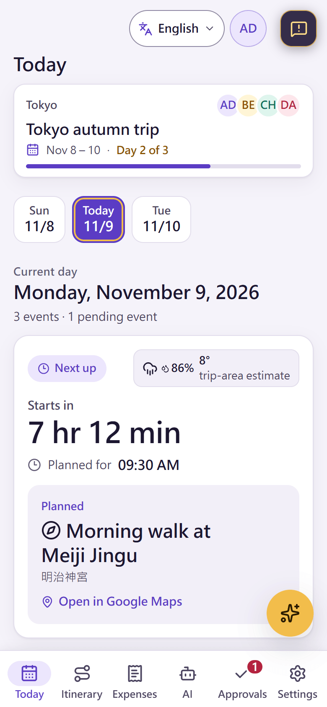
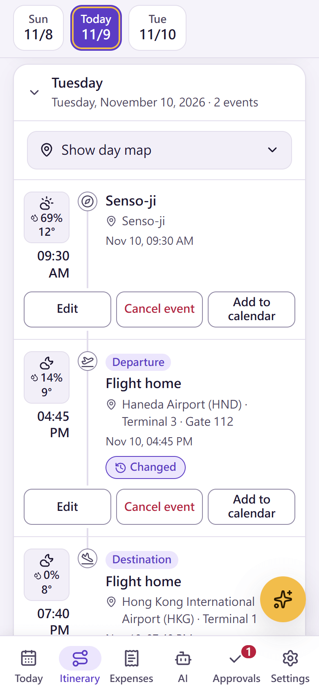
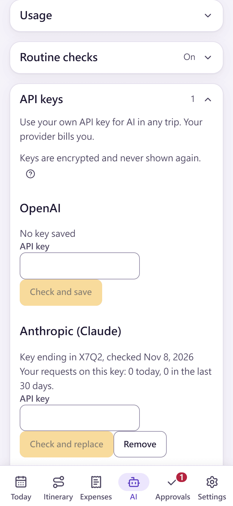

# Stardust Itinerary · 星塵遠征軍

A travel AI assistant that organizes trips for a group or just for you: one shared itinerary, expenses that settle themselves, and AI that keeps an eye on your flights and plans. Application code, not the model, decides what changes.

**Try it:** <https://stardust-itinerary.chl-work.com>. Sign in with Google, or start a guest trip that is deleted after 24 hours.

<p align="center">
  
  
  
  
  
</p>
<p align="center"><sub>Overview · a flight time changed by a routine check · AI proposal · day map · API keys. Synthetic data on a local build.</sub></p>

## Why I built this

I wanted a travel AI assistant that organizes travel, for a group or just for me. I got tired of recording and calculating expenses, begging friends to pay me back, and checking whether something unexpected had happened to a flight or a plan. Stardust does that work for me.

## What it does

- **Watches for surprises:** save your own AI key and routine checks turn on by themselves, looking up your flights and events automatically: delays, cancellations, gate and terminal changes, closures, strikes and severe weather. Changes and warnings appear on the event, and an open page can notify you.
- **Events from a photo:** take a picture of a ticket, a booking or a screenshot, and the AI creates the event (on your own key).
- **Paste an email or a text:** paste a confirmation email or a message, and the AI turns it into events and expenses.
- **Expenses that add up:** who paid, who owes whom, repayments and suggested settlements, all calculated by code, so nobody has to chase the numbers.
- **One shared itinerary:** each day in time order with local clocks, private events, day maps and weather.
- **Usage you can see:** the AI tab charts your tokens per day with an estimated cost.
- **Free or your own key:** free AI for text planning, or your own OpenAI, Anthropic or Gemini key. Keys are encrypted (Cloud KMS, kept in Google Secret Manager on the public instance) and never shown again.
- **Twelve languages:** English, Cantonese, Japanese, Simplified and Traditional Chinese, Spanish, Portuguese, French, German, Russian and Indonesian.

## Install it on your phone

Open <https://stardust-itinerary.chl-work.com> on your phone and tap **Install** (on Android, the install prompt or ⋮ → Install app; on iPhone, Safari's Share → **Add to Home Screen**). It then opens like an app and keeps a read-only offline copy of your itinerary.

## Try it and tell me what you think

The public instance runs on Google Cloud (GKE Autopilot) and is open to anyone while my $300 Google Cloud credit lasts. Please report bugs and feature requests as an [issue in this repository](https://github.com/CHL-work/stardust-itinerary/issues), or with the feedback button in the app.

## Find your way

| To | Start with |
| --- | --- |
| Understand the product | [Design](docs/DESIGN.md), [decisions](docs/DECISIONS.md), [case study](docs/CASE_STUDY.md) |
| Understand the code | [Architecture](docs/ARCHITECTURE.md), [implementation and source map](docs/IMPLEMENTATION.md), [database](docs/DATABASE.md), [AI](docs/AI_AND_AGENTS.md) |
| Review security and privacy | [Identity and security](docs/IDENTITY_AND_SECURITY.md), [threat model](docs/THREAT_MODEL.md), [privacy notice](docs/PRIVACY.md), [reporting a vulnerability](SECURITY.md) |
| Run your own | [Docker Compose](docs/SELF_HOSTING.md) or [GKE Autopilot](docs/DEPLOYMENT.md) |
| Contribute, as a person or an AI agent | [Contributing](CONTRIBUTING.md), [agent rules](AGENTS.md), [roadmap](docs/ROADMAP.md), [jobs](docs/jobs/README.md), [changelog](CHANGELOG.md) |
| Find a feature's contract | [Documentation index](docs/README.md) |

## Develop

```bash
pnpm install
cp .env.example .env.local   # AUTH_SECRET, a Google OAuth client, a local PostgreSQL 17
pnpm db:migrate
pnpm dev                     # http://127.0.0.1:3100
```

`pnpm check` runs lint, types, unit tests, the database suite, the build and a smoke test. Built with Next.js 16, React 19, TypeScript and PostgreSQL 17.

## License

[Apache License 2.0](LICENSE); see [NOTICE](NOTICE). The bundled locality time-zone data is adapted from [GeoNames](https://www.geonames.org/) under CC BY 4.0 ([attribution and changes](src/lib/app/place-time-zones.LICENSE)), and the airport catalog from mwgg/Airports under MIT ([license](src/lib/app/airport-time-zones.LICENSE)).
