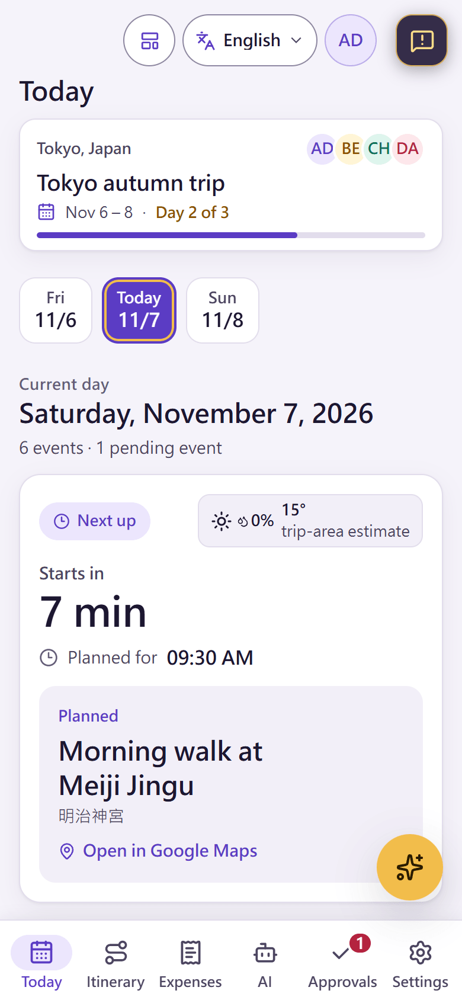
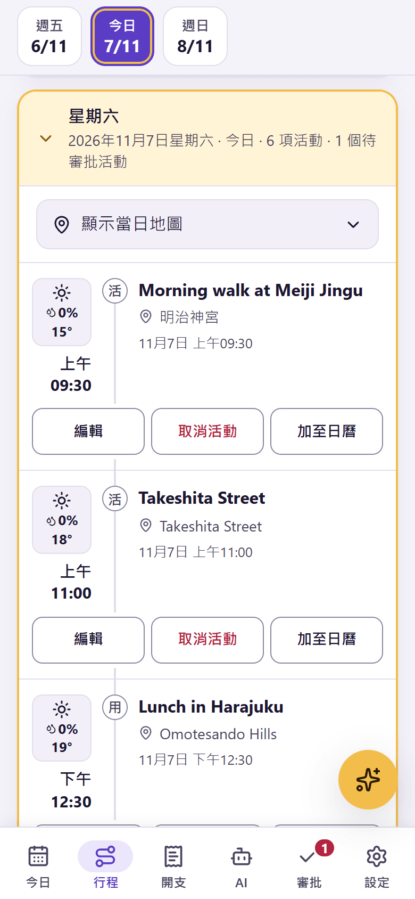
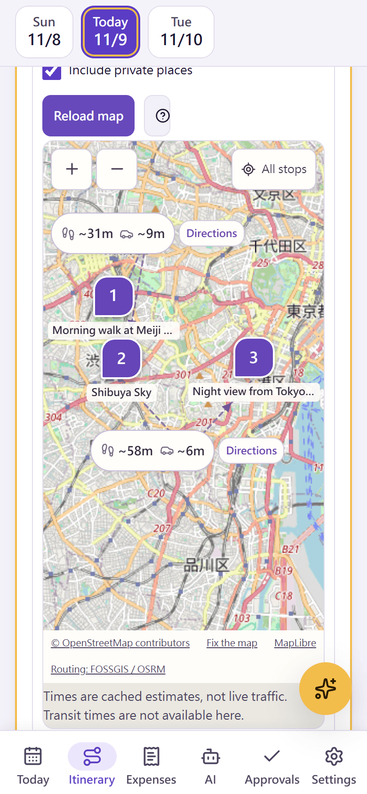
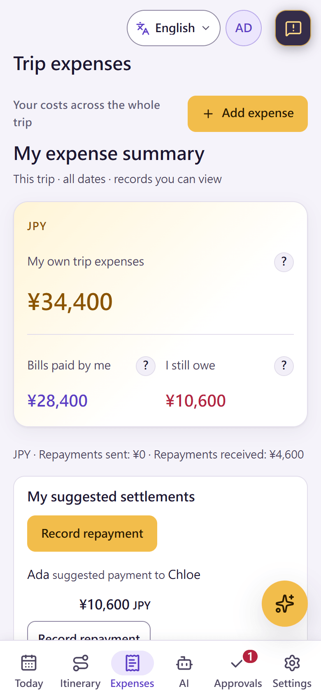
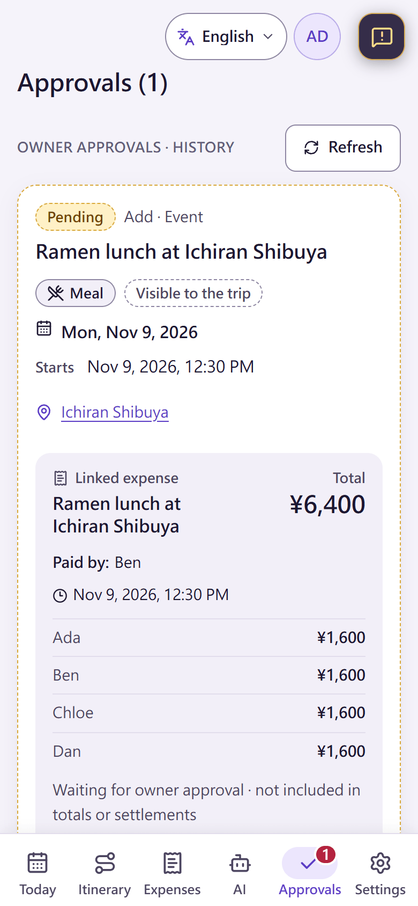

# Stardust Itinerary · 星塵遠征軍

A mobile-first planner for group trips, where AI proposes and application code decides: one shared itinerary, expense splitting, day maps, weather and disruption checks. In English, Cantonese, Japanese, Simplified and Traditional Chinese, Spanish, Portuguese, French, German, Russian and Indonesian.

**Try it:** <https://stardust-itinerary.chl-work.com>. Sign in with Google, or try a guest demo trip with a few free AI requests; it is deleted after 24 hours.

<p align="center">
  
  
  
  
  
</p>
<p align="center"><sub>Today · itinerary in Cantonese · day map · expenses · AI proposal awaiting approval. Synthetic data on a local build.</sub></p>

## Highlights

- **One itinerary per day:** events, transport and lodging in time order. Private events stay with the people involved, and owners review changes.
- **Expenses that add up:** equal or exact shares, totals per currency, repayments and suggested settlements, all calculated by code, not by a model.
- **AI that proposes:** chat, or paste a booking screenshot or an event link. The model drafts events and expenses; the app checks them, and changes wait for review. On your own key, new items you could add yourself go straight in.
- **Maps and weather:** numbered OpenStreetMap day maps with walking and driving times, a forecast for each stop and checks for official disruption notices.
- **Your key stays yours:** bring an OpenAI, Anthropic or Gemini key. On the public instance it is sealed by a Cloud KMS key that only the web server can use, not even the site's operator.
- **Made for phones:** swipeable days, a read-only offline copy, and AI requests that survive the phone going to sleep.

## Find your way

| To | Start with |
| --- | --- |
| Understand the product | [Design](docs/DESIGN.md), [decisions](docs/DECISIONS.md), [case study](docs/CASE_STUDY.md) |
| Understand the code | [Architecture](docs/ARCHITECTURE.md), [implementation and source map](docs/IMPLEMENTATION.md), [database](docs/DATABASE.md), [AI](docs/AI_AND_AGENTS.md) |
| Review security and privacy | [Identity and security](docs/IDENTITY_AND_SECURITY.md), [threat model](docs/THREAT_MODEL.md), [privacy notice](docs/PRIVACY.md), [reporting a vulnerability](SECURITY.md) |
| Run your own | [Docker Compose](docs/SELF_HOSTING.md) or [GKE Autopilot](docs/DEPLOYMENT.md) |
| Contribute, as a person or an AI agent | [Contributing](CONTRIBUTING.md), [agent rules](AGENTS.md), [roadmap](docs/ROADMAP.md), [jobs](docs/jobs/README.md), [changelog](CHANGELOG.md) |
| Find a feature's contract | [Documentation index](docs/README.md) |

## Develop

```bash
pnpm install
cp .env.example .env.local   # AUTH_SECRET, a Google OAuth client, a local PostgreSQL 17
pnpm db:migrate
pnpm dev                     # http://127.0.0.1:3100
```

`pnpm check` runs lint, types, unit tests, the database suite, the build and a smoke test. Built with Next.js 16, React 19, TypeScript and PostgreSQL 17.

## License

[MIT](LICENSE)
