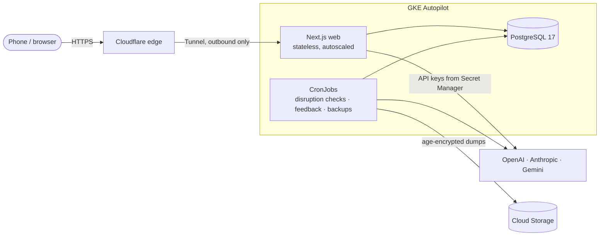

# Stardust Itinerary · 星塵遠征軍

A mobile-first, AI-assisted planner for group trips: one shared itinerary, private events, expense splitting and repayments, Google Calendar import, day maps, weather and disruption checks. Interface in English, Hong Kong Cantonese (two tones) and Japanese.

**Live instance:** <https://stardust-itinerary.chl-work.com>. You currently need an invitation to a trip to get in. Bring-your-own API keys, trip owners sharing their keys with members, and a guest mode with 24-hour demo trips are built; guest mode waits to be switched on. See the [roadmap](docs/ROADMAP.md).

## What it does

- **Shared itinerary, per-day.** Events with optional end times, transport legs with separate departure and arrival rows, lodging, notes and pending proposals in their real timeline positions. Owners review changes; nothing silently replaces an approved plan.
- **Private where it matters.** Private events and expenses are visible only to the people involved. There is no owner read bypass, and every query is scoped to the caller's membership.
- **Expenses that add up.** Bills linked to events, equal or exact per-person shares in minor units, multi-currency totals, and repayments between members. All money arithmetic is deterministic application code.
- **AI that proposes, never decides.** Chat in any of the four languages or paste a picture of a booking. The model drafts typed proposals (events, expenses, edits) backed by live web research where needed. Application code validates, authorizes and stores them as pending items for review.
- **Calendar, maps and weather.** Optional Google Calendar import and conflict hints, numbered day maps on OpenStreetMap, Open-Meteo forecasts per stop, and background checks for official disruption notices.
- **Works on a phone, even offline.** A read-only offline copy of the public itinerary, resumable AI requests and swipeable days.

## How it is built



- **App:** Next.js 16 (App Router), React 19, TypeScript, Zod. One container image runs the web server, the workers, migrations and backups.
- **Data:** PostgreSQL 17 is the source of truth. Forward-only SQL migrations with checksums, append-only audit and revision tables, row-level scope checks in every query, database constraints and triggers for invariants such as the last active owner and deleted-trip lockout.
- **AI:** official OpenAI Codex SDK and Claude Agent SDK adapters with an explicit environment allowlist, typed output schemas, evidence requirements for researched facts, and recovery of in-flight requests after a phone suspends.
- **Infrastructure as code:** OpenTofu for the Google Cloud project (Autopilot cluster, Artifact Registry, Secret Manager, keyless GitHub deploys, budget alert) and Kustomize for Kubernetes. No service-account keys exist anywhere.
- **Quality gate:** ESLint, TypeScript, 4,500+ Vitest tests and a PostgreSQL integration suite on every push (`pnpm check`).

More detail: [architecture](docs/ARCHITECTURE.md), [design](docs/DESIGN.md), [decisions](docs/DECISIONS.md), [identity and security](docs/IDENTITY_AND_SECURITY.md), [database](docs/DATABASE.md), [AI](docs/AI_AND_AGENTS.md).

## Run it yourself

- **Docker Compose** on one machine: [self-hosting guide](docs/SELF_HOSTING.md). About five minutes with a Google OAuth client and at least one AI provider key.
- **Kubernetes / GKE:** [deployment guide](docs/DEPLOYMENT.md), using `deploy/k8s` and `infra/`.

## Develop

```bash
pnpm install
cp .env.example .env.local   # fill in AUTH_SECRET, Google client, a local PostgreSQL 17
pnpm db:migrate
pnpm dev                     # http://127.0.0.1:3100
```

`pnpm check` runs lint, types, unit tests, the database suite (needs `TEST_DATABASE_URL` pointing at a disposable database), the production build and a smoke test. See [contributing](CONTRIBUTING.md) and [AGENTS.md](AGENTS.md) for the rules humans and coding agents follow here.

## License

[MIT](LICENSE)
