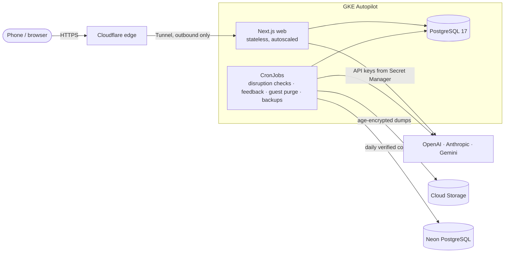

# Deployment on GKE Autopilot

How the public instance runs, and how to run your own the same way. For a single machine, see [self-hosting](SELF_HOSTING.md).

## What runs where



| Piece | Where | Notes |
| --- | --- | --- |
| Web server | `stardust-web` Deployment, autoscaled 1–2 replicas | Stateless; probes on `/api/health` |
| PostgreSQL 17 | `stardust-db` StatefulSet, 10 GiB `pd-balanced` disk | Only application pods may connect (NetworkPolicy) |
| Public access | `stardust-tunnel` (cloudflared) | Outbound-only Cloudflare Tunnel; no load balancer or public IP |
| Background work | CronJobs `stardust-disruption` (every 5 min), `stardust-feedback` (hourly review), `stardust-feedback-publish` (hourly issue filing), `stardust-guest-purge` (hourly), `stardust-backup` (daily), `stardust-offsite-copy` (daily) | Each run is a short pod. The guest purge has its own service account and only the database administrator password, and reaches only the database. The feedback publisher has its own service account, the only one that can read the feedback repository token, and runs no model; the reviewer never holds the token. The off-site copy has its own service account, the only one that can read the off-site connection, and reaches only the database, DNS and port 5432 on public addresses |
| Migrations | `stardust-migrate`, a suspended CronJob used as a template | Started once per release by the deploy script |
| Secrets | Google Secret Manager, mounted as files by the GKE Secret Manager add-on | Each Kubernetes service account may read only its own secrets |
| Users' AI keys | Cloud KMS-sealed, with optional per-account Secret Manager storage (JOB-087) | Only the web server may act as the KMS credentials account; its deny policy is unchanged. Secret Manager stores ciphertext while PostgreSQL keeps a pinned reference. Activation is a separate operator step [below](#account-owned-keys-in-secret-manager) |
| Backups | `gs://<project>-backups`, age-encrypted, 30-day lifecycle | The backup job can create objects but not read or delete them |
| Off-site copy | A second PostgreSQL server outside Google Cloud; the public instance uses a Neon free-plan project | Each day the database is restored there as a dated database whose row counts are checked against the source; the newest three are kept within a 500 MB budget. Unlike the backups, it is readable by whoever holds its connection string (D-083) |
| Images | Artifact Registry `<region>-docker.pkg.dev/<project>/stardust` | Keeps the 4 newest images; older ones are deleted after a week |

Managed cloud infrastructure is declared in [`infra/`](../infra) (OpenTofu); cluster workloads in [`deploy/k8s`](../deploy/k8s) (Kustomize base plus the `gke` overlay). Account-key secret resources, when enabled, are created by the application and tracked in PostgreSQL, never OpenTofu state. No service-account keys exist: nodes, workloads and GitHub Actions all use Workload Identity.

Application pods run as non-root with read-only root filesystems and no Kubernetes API token. Network policies block HTTP access to cloud metadata except for the web server's KMS/Secret Manager identity and the optional delete-only credential cleanup worker. The cleanup worker has no KMS or provider-key access. AI provider subprocesses get only the allowlisted environment.

## One-time setup

You need `gcloud`, OpenTofu 1.8+, `kubectl` with `gke-gcloud-auth-plugin`, `cloudflared`, a Google billing account and a domain on Cloudflare.

1. **Project and state bucket:**

   ```bash
   infra/bootstrap.sh <project-id> <billing-account-id> [organization-id]
   ```

2. **Infrastructure.** Copy `infra/live.tfvars` with your values, then:

   ```bash
   cd infra
   tofu init -backend-config=bucket=<project-id>-tofu-state
   tofu apply -var-file=live.tfvars
   ```

   This creates the network, Autopilot cluster, registry, empty secrets, backup bucket, GitHub Actions identities and a budget alert. Creating the cluster takes about ten minutes.

3. **Secret values.** Add one version to each secret. Each is a file, never a command-line argument.

   | Secret | Content |
   | --- | --- |
   | `stardust-db-admin-password` | 64 hex characters (`openssl rand -hex 32`), no newline |
   | `stardust-app-env` | dotenv with `APP_BASE_URL`, `APP_ALLOWED_ORIGINS`, `AUTH_SECRET`, `GOOGLE_CLIENT_ID`, `GOOGLE_CLIENT_SECRET`, `OWNER_GOOGLE_EMAIL`, `PUBLIC_SIGNUP_ENABLED`, `DEFAULT_LOCALE`, `AUTH_TRIP_GRACE_DAYS`, `STARDUST_FEEDBACK_TRIAGE_ENABLED` and `DATABASE_URL=postgresql://stardust_app:<64 hex>@stardust-db:5432/stardust`. For guest mode also `GUEST_MODE_ENABLED=true`, `TURNSTILE_SITE_KEY` and `TURNSTILE_SECRET_KEY`. Optional keyless AI for every account: `FREE_AI_ENABLED=true`, with `FREE_AI_MODELS`, `FREE_AI_PER_USER_DAILY`, `FREE_AI_HOURLY` and `FREE_AI_DAILY` (see `.env.example`). Canonical settings override legacy `GUEST_FREE_AI_*`; an old enabled flag now also covers signed-in users. `PRIVACY_NOTICE_URL` (https) links your privacy notice from sign-in |
   | `stardust-ai-env` | dotenv with `OPENAI_API_KEY`, `CODEX_API_KEY`, `ANTHROPIC_API_KEY`, `STARDUST_GEMINI_API_KEY` (plus `STARDUST_GEMINI_VERTEX_PROJECT`/`_LOCATION` for a Vertex AI key) |
   | `stardust-credential-env` | dotenv with `CREDENTIAL_KMS_KEY` and `CREDENTIAL_KMS_SERVICE_ACCOUNT`, from `tofu output credential_kms_key` and `credential_kms_service_account`, so users' AI keys are sealed by Cloud KMS (see [keys in Cloud KMS](#users-keys-in-cloud-kms)). Without KMS, use `CREDENTIAL_ENCRYPTION_KEY=` 32 random bytes in base64 (`openssl rand -base64 32`) instead, plus, after a rotation, `CREDENTIAL_ENCRYPTION_KEY_VERSION` and `CREDENTIAL_ENCRYPTION_PREVIOUS_KEYS` (see [rotation](#rotating-the-encryption-key)). Only the web server mounts it. A local key must be kept with your recovery materials, or users' saved keys cannot be decrypted |
   | `stardust-credential-cleanup-env` | Optional JOB-087 cleanup-only dotenv: runtime `DATABASE_URL` and `CREDENTIAL_SECRET_MANAGER_PROJECT`, nothing else. No database-admin password, API keys, signing/OAuth secrets, KMS settings or impersonation account. Leave its CronJob suspended until configured; see [account-key storage](#account-owned-keys-in-secret-manager) |
   | `stardust-feedback-env` | dotenv with `STARDUST_FEEDBACK_REPOSITORY=<owner>/<private repository>` and `STARDUST_FEEDBACK_GITHUB_TOKEN`, a fine-grained token for that repository only with **Issues: read and write**. Only the feedback publish job mounts it. Without the token, issues stay queued; the publisher refuses a repository GitHub does not report as private ([feedback](FEEDBACK.md)) |
   | `stardust-offsite-env` | dotenv with `STARDUST_OFFSITE_DATABASE_URL`: a direct (not pooled) `postgresql://` URL, over TLS, to a maintenance database on the off-site server, whose role can create databases. Optionally `STARDUST_OFFSITE_KEEP` (copies kept, default 3) and `STARDUST_OFFSITE_MAX_MB` (budget for all copies, default 500). Only the off-site copy job mounts it. Without an off-site server, add a version with an empty `STARDUST_OFFSITE_DATABASE_URL=`: the job then does nothing |
   | `stardust-tunnel-credentials` | the tunnel credentials JSON from step 4 |

   ```bash
   gcloud secrets versions add stardust-app-env --data-file=app.env --project=<project-id>
   ```

   The migration job creates the `stardust_app` runtime role from `DATABASE_URL` and grants it only data access. The guest purge function suspends triggers for its own deletes, so only a superuser can run it. The runtime role is never granted it; the purge job connects as the administrator. On a managed database without a superuser, leave guest mode off.

4. **Tunnel:**

   ```bash
   cloudflared tunnel login
   cloudflared tunnel create stardust-gke
   cloudflared tunnel route dns stardust-gke <hostname>
   gcloud secrets versions add stardust-tunnel-credentials --data-file=<path-printed-by-create>.json --project=<project-id>
   ```

   Put the tunnel ID and your hostnames in `deploy/k8s/overlays/gke/tunnel-config.yaml`, and the project, region, bucket and age recipient in that overlay's `kustomization.yaml` and `secret-provider-classes.yaml`.

5. **Image:** export a clean tree and build it on Cloud Build. The `deploy` workflow does the same in CI.

   ```bash
   git archive --format=tar HEAD | (mkdir -p /tmp/src && tar -x -C /tmp/src)
   gcloud builds submit /tmp/src --config=deploy/cloudbuild.yaml --substitutions=_REVISION=$(git rev-parse HEAD) \
     --service-account=projects/<project-id>/serviceAccounts/image-builder@<project-id>.iam.gserviceaccount.com \
     --gcs-source-staging-dir=gs://<project-id>-build-sources/source
   ```

6. **First deploy:**

   ```bash
   gcloud container clusters get-credentials stardust --region=<region> --project=<project-id>
   deploy/deploy.sh $(git rev-parse HEAD) --skip-backup
   ```

## Releases

Every push to `main` deploys once CI passes. When CI succeeds for a push to `main`, the [`deploy` workflow](../.github/workflows/deploy.yml):

1. builds and pushes the image, tagged with the commit SHA, unless that image already exists;
2. runs [`deploy/deploy.sh`](../deploy/deploy.sh) in the `production` environment: shared objects and the database first, then a pre-migration backup, the migration job (which must succeed), the web rollout, effective free-AI/guest configuration verification, and a health check through the public URL.

The GKE web-only [`web-free-ai.yaml`](../deploy/k8s/overlays/gke/patches/web-free-ai.yaml) enables keyless AI for all accounts, including guests: 10 requests/account/day, 60 instance requests/attempts/hour and 500/day. The picker shows every eligible zero-price catalog model; `FREE_AI_MODELS` only orders automatic fallback. The fixed endpoint and explicit process environment take precedence over mounted Node `--env-file` values, including legacy settings. To disable this lane, change `FREE_AI_ENABLED` in the overlay to `false` and deploy; a secret-file override alone cannot disable it. Base/Compose deployments still opt in.

After rollout, `entrypoint.sh verify-free-ai-config --require-guest` checks effective settings without database or provider calls. It prints only enabled state, public model IDs, limits and guest/Turnstile mode. Guest mode must be enabled and its existing admission policy usable (configured Turnstile or an explicitly configured waiver); the check never creates a waiver or changes admission. Custom overlays may enable free AI without guest mode. A failed check fails the deployment workflow; it does not undo an already-completed rollout.

Through Workload Identity Federation, only `main` can push images and only the `production` environment can obtain cluster credentials. The identity provider accepts tokens only from `deploy.yml` as it is on `main`, for its own `workflow_run` and `workflow_dispatch` triggers, so no other workflow can get cloud credentials. The `production` environment accepts only `main`, and the workflow deploys only CI runs for pushes to `main` of this repository, never a pull request, even one whose branch is named `main`. An automatic deploy also needs the newest commit of `main`, checked again when the deploy job starts, so re-running an older CI run never rolls production back. Deploys run one at a time; a newer one waits for the running one.

Image tags are immutable in Artifact Registry, so a commit's tag always names the image CI built for it. The workflow's actions are pinned to commit SHAs.

To redeploy, run the workflow manually (**Actions → Deploy → Run workflow** on `main`), optionally with a revision. The revision must be a commit on `main`.

**Rollback:** run the workflow (or `deploy/deploy.sh`) with an earlier SHA. Migrations are forward-only; an older release must still work with the newer schema. See [database](DATABASE.md).

On your own instance, add required reviewers to the `production` environment if you want to approve each deploy; the public instance deploys without approval by the owner's choice.

## Operations

- **Logs:** `kubectl -n stardust logs deploy/stardust-web` (also in Cloud Logging). For CronJob runs, `kubectl -n stardust get jobs` and `kubectl logs job/<name>`.
- **Scaling:** change `minReplicas`/`maxReplicas` in `deploy/k8s/base/web.yaml`, or the pod `resources`; Autopilot provides the capacity. Autopilot bills pod requests, not nodes.
- **Deployment configuration secrets:** add a new version, then `kubectl -n stardust rollout restart deploy/stardust-web`; CronJob pods pick it up on their next run. Destroy old versions you no longer need. Users change their personal provider keys through Settings, not these configuration secrets.
- **Manual backup:** `kubectl -n stardust create job backup-now --from=cronjob/stardust-backup`.
- **Off-site copy:** `kubectl -n stardust create job offsite-now --from=cronjob/stardust-offsite-copy` runs one now. Its log line is `offsiteCopy: ok` with the new copy's name, table and row counts and the copies kept, or `offsiteCopy: failed` with the reason. A failed run never drops the newest verified copy. Copies are named `stardust_YYYYMMDD_HHMMSS` (UTC); a verified copy's database comment starts with `stardust-offsite-copy v1 verified`. The job refuses to start a copy that would not fit the budget next to the newest one.
- **Feedback token:** create a fine-grained token (**Settings → Developer settings → Fine-grained tokens**) with **Only select repositories** set to the private feedback repository and **Issues: read and write**, copy it, and add a `stardust-feedback-env` version that keeps the repository line. The next hourly `stardust-feedback-publish` run publishes queued issues; a run that refuses the repository exits non-zero and logs `publishing: refused` with a reason code.
- **AI load:** each web replica runs at most `STARDUST_AI_MAX_CONCURRENT` (default 4) AI requests at once, since each starts provider processes in the pod; more get HTTP 429 with `Retry-After`.
- **Guest purge:** a failed `stardust-guest-purge` run means the database refused to purge a guest that is not provably isolated. The guest stays in place, and the run logs only counts. Find it with `SELECT id FROM app_users WHERE guest_expires_at <= now()`, investigate, and never delete guest rows by hand.
- **Encryption-key rotation:** see [below](#rotating-the-encryption-key).
- **Restore:**
  1. Download the object and its `.json` manifest.
  2. Decrypt with the age identity: `age -d -i <key> -o db.dump <object>.dump.age`.
  3. `kubectl -n stardust port-forward svc/stardust-db 15432:5432`.
  4. `pg_restore --clean --if-exists -d postgresql://postgres:<admin>@127.0.0.1:15432/stardust db.dump`.
  5. Run the migration job.

  If the backups are gone too, take the dump from the newest verified off-site copy instead of steps 1 and 2: `pg_dump -Fc -f db.dump` with the off-site URL, naming that copy as the database.
- **Costs:** the cluster fee for one Autopilot cluster is covered by GKE's free tier. The always-on pods request about 0.4 vCPU and 1.6 GiB, and each job 0.1 vCPU, so a job fits next to them without a second node (about USD 20–30 a month at Tokyo list prices). Pods may burst above their CPU requests when the node has room. The budget alert in `infra/` emails at 50/90/100% of the configured amount. The off-site copy fits Neon's free plan (per project: 1 GB of storage and 100 CU-hours of compute a month, as of November 2026): with the compute fixed at 0.25 CU, each daily run keeps it awake for a few minutes. The Cloud KMS key costs about USD 0.06 a month per key version (one more each year), plus USD 0.03 per 10,000 encryptions and decryptions.
- **Free trial:** a Google Cloud free trial allows 250 GB of SSD-backed disk, which fits only two Autopilot nodes (100 GB boot disk each) plus the database disk, and it refuses quota increases. Keep requests small enough that the jobs fit on one node. If the autoscaler reports `scale.up.error.quota.exceeded`, it may give up on that pod for good: delete the pending job, and the next scheduled run starts normally.
- **End of the free trial:** the credit expires 90 days after sign-up, even after an upgrade to a paid billing account. Without an upgrade by then, Google stops everything and deletes it 30 days later, including the backups, which live in the same project. The off-site copy is outside Google Cloud and survives that. After an upgrade, usage beyond the remaining credit is charged and quota increases can be requested.

## Rotating the encryption key

Users' saved AI keys are sealed under a key ring ([identity and security](IDENTITY_AND_SECURITY.md)). To replace the key:

1. Add a `stardust-credential-env` version with a new `CREDENTIAL_ENCRYPTION_KEY`, the next `CREDENTIAL_ENCRYPTION_KEY_VERSION`, and the old key in `CREDENTIAL_ENCRYPTION_PREVIOUS_KEYS` as `<old version>:<old key>`.
2. `kubectl -n stardust rollout restart deploy/stardust-web`. New keys are now sealed with the new version, and old ones still open.
3. `kubectl -n stardust exec deploy/stardust-web -- /app/deploy/container/entrypoint.sh credential-reencrypt`. It prints counts only, and exits non-zero while any key remains under an older version.
4. Add a version without `CREDENTIAL_ENCRYPTION_PREVIOUS_KEYS`, restart the web server again, and disable the old secret versions.

Backups taken before the rotation still hold ciphertexts under the old key. Keep that key with your recovery materials until those backups expire (30 days).

## Users' keys in Cloud KMS

`infra/` creates the KMS key and the `stardust-credentials` service account, which is the only principal allowed to use the key. Applying the deny policy needs `roles/iam.denyAdmin` on the organization. Grant it for the apply, then keep `roles/iam.denyReviewer` so that later plans can still read the policy. Changing the deny policy, the grants or the deployed code leaves a record in Admin Activity logs or in Git.

To move an instance's saved keys from the local ring to KMS:

1. Add a `stardust-credential-env` version with `CREDENTIAL_KMS_KEY` and `CREDENTIAL_KMS_SERVICE_ACCOUNT` next to the existing `CREDENTIAL_ENCRYPTION_KEY`, then `kubectl -n stardust rollout restart deploy/stardust-web`. New keys are now sealed by KMS, and old ones still open with the ring.
2. `kubectl -n stardust exec deploy/stardust-web -- /app/deploy/container/entrypoint.sh credential-reencrypt`. It first seals and opens a synthetic value, which proves that the server can use the key even before any key is saved. It then moves every ring-sealed key into KMS, and opens every KMS-sealed key once. It prints counts only, and exits non-zero while a key is left under the ring or does not open.
3. Add a version with only the two KMS settings, restart the web server, and run step 2 again.
4. Disable the old secret versions. Backups and off-site copies taken before the move still hold ring ciphertexts for up to 30 days. Destroying the old versions makes those unreadable for good: a restore from such a backup then needs users to add their keys again, but nobody can open them.

To check the key's use, read the Data Access logs: `protoPayload.serviceName="cloudkms.googleapis.com"`. Each entry shows the service account and, through delegation, the identity that acted as it.

## Account-owned keys in Secret Manager

JOB-087 adds this storage backend but does **not** enable it on an existing instance. Users still paste their own OpenAI, Anthropic or Gemini key in **Settings → AI keys**. It belongs to their immutable account across trips, not their email text or the operator's environment. No keys are imported or shared automatically.

### Enable after operator approval

1. Review/apply `infra/user-credential-secrets.tf` with the existing infrastructure. It adds narrowly scoped custom roles, a cleanup-only configuration secret and Secret Manager Data Access logging. Do not change the KMS deny policy. Application deployment does not apply this infrastructure.
2. Deploy the JOB-087 migration and compatible application before accepting new storage references. Existing database ciphertexts still open with their original KMS/local configuration; no bulk migration happens automatically.
3. Populate `stardust-credential-cleanup-env` with only the runtime `DATABASE_URL` and `CREDENTIAL_SECRET_MANAGER_PROJECT` (the `credential_secret_manager_project` output). Set the project in its SecretProviderClass using the same overlay project as the other secrets. Never use the database administrator connection or copy the full app dotenv.
4. Set `suspend: false` in `deploy/k8s/overlays/gke/credential-secret-cleanup.yaml` and deploy that authorized change. Run a manual job from `stardust-credential-secret-cleanup` to verify DB/configuration access; it prints counts only. The job runs every 15 minutes, retries failed resources later and checks that no current credential references a resource before deleting it.
5. Add `CREDENTIAL_SECRET_MANAGER_PROJECT` and `CREDENTIAL_SECRET_MANAGER_SERVICE_ACCOUNT` (the two matching OpenTofu outputs) to the web-only `stardust-credential-env`. Keep both existing `CREDENTIAL_KMS_*` settings and any local ring needed by older keys. Restart the web deployment through the authorized release procedure. New saves now use Secret Manager; users can re-enter existing keys to move them individually.
6. Verify a controlled account's save, provider visibility and removal through Settings. Never print payloads or run `secrets versions access` to inspect them. Verify the cleanup job completes and monitor its failure counts before considering the rollout complete.

### Boundaries and lifecycle

Each save creates a new `stardust-user-key-…` resource containing **KMS ciphertext**, bound to the account and provider. The database stores the pinned version and display metadata, not that payload. Existing KMS denial still prevents other principals from decrypting it. The web identity may create empty secrets at project scope (Google checks `secrets.create` on the project), but may add/read payloads only under the dedicated prefix; it cannot change secret IAM. The separate cleanup identity may delete only that prefix, cannot read payloads, and cannot impersonate the KMS account. [Google's create permission](https://docs.cloud.google.com/secret-manager/docs/reference/rest/v1/projects.secrets/create) · [least privilege](https://docs.cloud.google.com/secret-manager/docs/access-control).

A durable, opaque resource registry is written before cloud creation. Replaced, deleted or abandoned resources become cleanup candidates after the staging lease; active references always win. A failed cleanup is retried without extending a save's fixed publication deadline. Guests' resources additionally expire at the account's original 24-hour deadline; near-expiry saves are refused, never extended. The privileged database guest purge stays unchanged and gets no cloud permissions. [Secret expiration](https://docs.cloud.google.com/secret-manager/docs/creating-and-managing-expiring-secrets).

**Recovery:** keep a JOB-087-compatible image and all required Secret Manager/KMS configuration after the first reference is saved. An older image or removing that configuration cannot open those keys. Database backups/off-site copies contain references only; they do not back up cloud secret payloads. A restored reference to a since-deleted secret requires its user to paste the key again. Retired resources are not resurrected by a database restore. Keep the cleanup job suspended while restoring or comparing historical databases, and never point a second writer/cleanup instance at the production secret project.

**Cost:** Google currently charges about USD 0.06 per active version/month beyond six free versions and USD 0.03 per 10,000 accesses beyond 10,000 free accesses; allowances are per billing account. Three saved providers are roughly USD 0.18/user/month before allowances, plus KMS and short cleanup jobs. Cleanup prevents superseded versions accumulating; disabled versions still count as active. [Secret Manager pricing](https://cloud.google.com/secret-manager/pricing).

## Moving an existing instance

To move a running instance without losing writes:

1. Stop the old instance's web server and workers.
2. Take a final `pg_dump -Fc`.
3. Restore it into the new database as above.
4. Run the migration job; checksums that differ only in line endings are accepted.
5. Set `APP_BASE_URL` to the public hostname.
6. Route the hostname to the new tunnel: `cloudflared tunnel route dns --overwrite-dns stardust-gke <hostname>`.

Keep the same `AUTH_SECRET` and Google OAuth client, so sessions, invitations and encrypted Calendar connections keep working.
